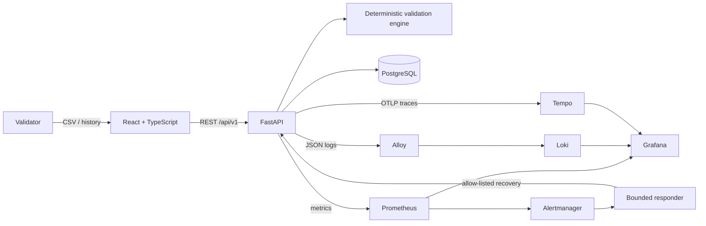

# Credit Risk Validation Tracker

An end-to-end, observable application for validating synthetic probability-of-default (PD) datasets and retaining an auditable validation history.

> **Educational demonstration — not regulatory advice.** PASS/WARNING/FAIL thresholds in this repository are configurable example policy. They are not OSFI, Basel, EBA, IFRS 9, or any other regulatory requirements. Do not upload customer or confidential data.

## Problem and expected behavior

Model validators repeatedly check input quality, compare predicted PD with observed defaults, assess calibration, document findings, and return to earlier runs. Spreadsheet-only workflows can make formulas, policy thresholds, evidence, and operational failures difficult to reproduce.

Credit Risk Validation Tracker gives validators a single workflow that:

- accepts a synthetic CSV with `observation_id`, `predicted_pd`, and `default_flag`;
- rejects invalid schema, types, probabilities, outcomes, or empty files with actionable errors;
- reports nulls, duplicates, format errors, and out-of-range values;
- calculates average PD, observed default rate, Brier Score, and equal-frequency calibration groups deterministically;
- applies documented configurable demonstration rules to produce PASS, WARNING, or FAIL findings;
- displays results and calibration in a responsive React dashboard;
- persists validation history in PostgreSQL;
- exposes a versioned REST API and generated OpenAPI documentation;
- correlates a real upload journey across metrics, JSON logs, and OpenTelemetry traces;
- reproduces a safe user-impacting incident and routes its alert to a bounded responder.

The primary users are credit-risk model validators, risk analysts, validation leads, and engineers who support model-risk tooling. The application does not train or approve models.

## Architecture



See [Architecture](docs/ARCHITECTURE.md) for request, security, and failure flows.

## Try it locally with one command

Requirements: Docker Desktop and Docker Compose v2.

```bash
docker compose up --build
```

Then open:

| Interface | URL |
|---|---|
| Dashboard | http://localhost:3000 |
| OpenAPI / Swagger | http://localhost:8000/docs |
| Grafana | http://localhost:3001 |
| Prometheus | http://localhost:9090 |
| Alertmanager | http://localhost:9093 |

If a host port is occupied, copy `.env.example` to `.env` and change its `CRVT_*_PORT` value.

### Example API flow

```bash
curl -F "file=@sample-data/valid_portfolio.csv" \
  http://localhost:8000/api/v1/validations

curl http://localhost:8000/api/v1/validations
```

A successful response includes the validation resource and an `X-Trace-ID` header. The supplied valid sample currently produces a deterministic WARNING under the example policy; that status is a demonstration result, not a regulatory conclusion.

## CSV contract

| Column | Type | Rule |
|---|---|---|
| `observation_id` | string | required and non-null; duplicates are counted |
| `predicted_pd` | number | required; inclusive range `[0,1]` |
| `default_flag` | integer | required; exactly `0` or `1` |

UTF-8 CSV files up to the configured size are supported. `sample-data/valid_portfolio.csv` and `sample-data/invalid_portfolio.csv` are synthetic fixtures.

### Deterministic calculations

- Average PD: arithmetic mean of `predicted_pd`.
- Observed default rate: arithmetic mean of `default_flag`.
- Brier Score: mean squared error `(predicted_pd - default_flag)^2`.
- Calibration: observations sorted by PD and divided into up to ten equal-frequency groups; each group reports average PD and observed default rate.
- Calibration gap: absolute portfolio-level difference between average PD and observed default rate.

Example thresholds are environment variables (`PASS_BRIER_MAX`, `WARNING_BRIER_MAX`, `PASS_CALIBRATION_GAP_MAX`, and related settings). The API returns the active policy and disclaimer with every detailed validation.

## API

| Method | Path | Purpose |
|---|---|---|
| `GET` | `/health` | API/database health and incident state |
| `GET` | `/metrics` | Prometheus exposition |
| `POST` | `/api/v1/validations` | Upload and persist a CSV validation |
| `GET` | `/api/v1/validations` | Paginated validation history |
| `GET` | `/api/v1/validations/{id}` | Detailed validation evidence |
| `GET` | `/api/v1/ops/incident` | Read safe incident state (ops token) |
| `POST` | `/api/v1/ops/incident/enable` | Enable reversible upload failure (ops token) |
| `POST` | `/api/v1/ops/incident/recover` | Disable failure flag (ops token) |

The generated contract is available at `/openapi.json` and interactively at `/docs`.

## Tests

Run all deterministic suites and the frontend build:

```powershell
./scripts/test.ps1
```

or:

```bash
make test
```

Individually:

```bash
python -m pytest backend/tests
python -m pytest oncall/tests
npm --prefix frontend test -- --run
npm --prefix frontend run build
```

Verified local results on 2026-10-25:

- backend: **21 passed**;
- bounded responder: **2 passed**;
- frontend: **8 passed** across two test files;
- frontend production build: **passed**;
- `npm ci` audit: **0 vulnerabilities**;
- Compose configuration: **valid**;
- backend, frontend, and responder images: **built successfully before the final hardening patch**; a rebuild is pending because Docker Desktop is currently unavailable on the host;
- Compose upload through the frontend proxy: **HTTP 201**;
- PostgreSQL persistence after database/backend restart: **verified**.

See [Testing Strategy and Evidence](docs/TESTING.md) and [Evaluation](docs/EVALUATION.md) for limitations and runtime evidence.

## Observability and safe incident demo

The upload journey emits:

- `crvt_validation_requests_total` and normalized HTTP metrics to Prometheus;
- `crvt_validation_incident_active`, which becomes `1` only after a real simulated user failure and returns to `0` after recovery;
- structured JSON logs containing the request trace ID to Loki through Alloy;
- OpenTelemetry traces to Tempo;
- `X-Trace-ID` in the HTTP response for correlation in Grafana.

No CSV rows, observation IDs, credentials, or operational tokens are sent to telemetry.

Run the safe incident scenario only against the local demo stack:

```powershell
./scripts/demo-incident.ps1
```

The flag causes upload requests to return `503` without deleting data. Prometheus raises `ValidationUserImpact`, Alertmanager wakes the responder, and the responder may perform only one fixed recovery action before checking health and submitting a synthetic probe. See [Observability](docs/OBSERVABILITY.md) and [Incident Response](docs/INCIDENT_RESPONSE.md).

## Delivery and rollback

| Stage | Trigger | Control |
|---|---|---|
| CI | every PR and `main` push | backend, frontend, responder, Compose and Prometheus checks |
| Development | successful CI on `main` | automatic deploy hook |
| Production | manual workflow dispatch | protected environment and exact 40-character SHA |
| Rollback | manual workflow dispatch | known-good exact SHA and incident reference |

`render.yaml` describes frontend, backend, and managed PostgreSQL deployment. External deployment status is recorded honestly in [Submission Status](docs/SUBMISSION_STATUS.md); configuration is not presented as proof of a live deployment.

## Product and agent workflow

The project was built by a real Codex agent team with separate backend, frontend, QA/SRE, and enterprise documentation responsibilities. The Lead integrated contracts and independently reran tests. Two cross-component defects in the initial incident path were found during review and corrected before finalization.

- [Product specification and acceptance criteria](docs/PRODUCT_SPEC.md)
- [Task tracker seed and agent usage log](docs/TASK_TRACKER.md)
- [Agent team and collaboration process](docs/AGENT_TEAM.md)
- [Project context](AGENTS.md)

The public GitHub Issues tracker is the canonical external backlog after publication; local task IDs preserve the pre-publication history.

## Documentation index

Academic/evaluator documentation is in English:

- [Product specification](docs/PRODUCT_SPEC.md)
- [Architecture](docs/ARCHITECTURE.md)
- [Agent team](docs/AGENT_TEAM.md)
- [Testing](docs/TESTING.md)
- [Deployment and rollback](docs/DEPLOYMENT.md)
- [Observability](docs/OBSERVABILITY.md)
- [Incident response](docs/INCIDENT_RESPONSE.md)
- [Security review](docs/SECURITY_REVIEW.md)
- [Rubric evaluation](docs/EVALUATION.md)
- [Submission status](docs/SUBMISSION_STATUS.md)

Additional Spanish study material:

- [Guía completa de aprendizaje](docs/PROJECT_LEARNING_GUIDE_ES.md)
- [Análisis de brechas enterprise — sanitizado](docs/PROJECT_LEARNING_GUIDE_ES.md)
- [Roadmap de mejoras enterprise — sanitizado](docs/PROJECT_LEARNING_GUIDE_ES.md)

Private repository evidence is deliberately omitted from the public reports. Public-source conclusions retain file/function references; private-source conclusions remain capability-level and identify their verification limits.

## Security and limitations

- Synthetic data only; no enterprise/client data or source code is included.
- `.env` is ignored; examples contain local-only placeholders.
- Compose host ports bind to `127.0.0.1`; public deployments must provide non-placeholder credentials.
- Uploads have independent request-byte, CSV-row, error-detail and retained-history limits.
- Operational endpoints require an ops token and are never called by the browser UI.
- The responder ignores alert text as instructions and cannot run shell commands or delete data.
- The demo does not provide production identity, RBAC, TLS termination, enterprise secrets, retention controls, migration governance, or regulatory approval.
- A production implementation needs institutional Security, Infrastructure, Architecture, and Model Risk approval.

## AI Dev Tools Zoomcamp 2026

This repository targets all 12 criteria in the official [Project 1 rubric](https://github.com/DataTalksClub/ai-dev-tools-zoomcamp/blob/main/project/README.md). Evidence and limitations are mapped criterion by criterion in `docs/EVALUATION.md`.

Passing the project also requires reviewing three peer projects on the course platform. Those reviews are separate from building/submitting this repository and are not claimed complete here.
