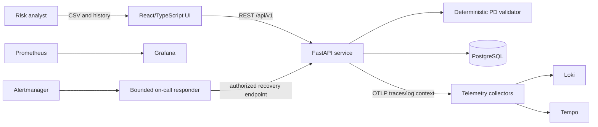

# Architecture

## System context

## Key decisions

- FastAPI provides validation, history, health and safe incident-control endpoints plus generated OpenAPI.
- SQLAlchemy isolates persistence; PostgreSQL is used in Compose and SQLite is allowed only for fast automated tests.
- React renders upload, results, findings, calibration and history from the REST contract.
- Validation calculations are deterministic and independent of any LLM.
- Example classification thresholds are environment-driven and explicitly non-regulatory.
- The incident responder has a fixed action allow-list; it does not execute arbitrary shell or generated commands.

## Primary request flow

1. UI sends multipart CSV to `POST /api/v1/validations`.
2. API validates schema and values, calculates statistics and risk groups, persists the result.
3. API returns a validation resource and trace ID; the UI renders it.
4. Middleware emits a request metric and JSON log with the same trace ID; OpenTelemetry exports the trace.

## Failure and recovery flow

1. An authenticated demonstration endpoint enables a reversible failure flag.
2. Upload attempts return `503`, incrementing the user-impact failure metric.
3. Prometheus evaluates the alert and sends it to Alertmanager/webhook responder.
4. The responder checks diagnostics, performs only the pre-authorized flag reset, and probes recovery.

## Security boundary

The project is an educational public demo. Production use requires identity, authorization, managed secrets, encrypted transport, retention controls, dependency governance and institutional approval.
