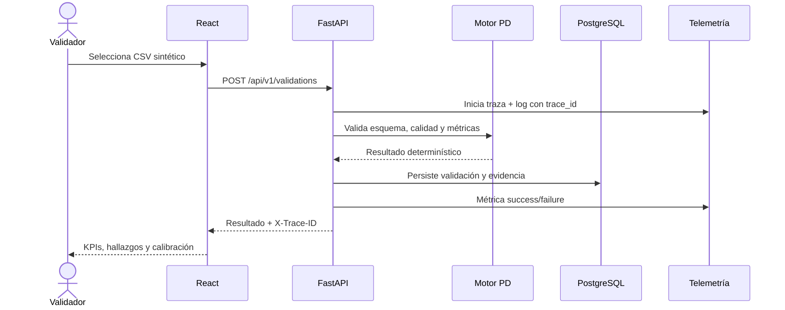

# Guía de aprendizaje del Credit Risk Validation Tracker

## Propósito y punto de partida

Esta guía está pensada para una persona que conoce riesgo de crédito, datos y validación de modelos, pero está consolidando ingeniería de software. El proyecto no pretende sustituir un marco de Model Risk Management ni definir tolerancias regulatorias. Usa datos sintéticos y una política de demostración configurable para enseñar cómo convertir un cálculo analítico en un producto operable, comprobable y recuperable.

La idea central es sencilla: una métrica correcta no basta. Para que un sistema sea confiable también debemos saber qué contrato ofrece, dónde persiste evidencia, cómo se prueba, cómo se despliega, qué ocurre cuando falla y cómo volvemos a un estado sano.

## 1. Flujo completo



El CSV requiere `observation_id`, `predicted_pd` y `default_flag`. El backend verifica estructura y dominio, calcula PD promedio, tasa de default observada y Brier Score, forma grupos de calibración y clasifica hallazgos. La interfaz no recalcula ni inventa: presenta el recurso devuelto por la API.

## 2. React y TypeScript

### A. Intuición

React ayuda a construir la interfaz como componentes que reaccionan a cambios de estado. TypeScript agrega tipos a JavaScript: permite detectar durante el build que un resultado de API no tiene la forma esperada. En validación de riesgo, esto reduce el riesgo de mostrar `average_pd` como si fuera `default_rate` o ignorar un campo obligatorio.

### B. Explicación técnica

El navegador carga una aplicación de página única. React mantiene estados para archivo, carga, error, resultado e historial. Cuando cambia un estado, recalcula la representación del componente. TypeScript comprueba los tipos en desarrollo/build, pero no valida por sí solo datos externos; por eso el contrato del backend sigue siendo la autoridad.

### C. Implementación real

El código está en `frontend/src/`. El cliente HTTP encapsula los endpoints `/api/v1/validations`; los componentes presentan tarjetas de métricas, hallazgos, tabla de calidad y gráfico de calibración. Vite ejecuta el entorno de desarrollo y genera `frontend/dist`; Nginx sirve ese build en el contenedor.

### D. Ejemplo práctico

Después de enviar `sample-data/valid_portfolio.csv`, la UI guarda el resultado recibido y dibuja cada grupo de calibración con PD media frente a default observado. Una respuesta `422` se convierte en un mensaje visible, no en una pantalla silenciosamente rota.

### E. Aplicación empresarial

Una interfaz tipada puede separar vistas de evidencia cuantitativa, fuentes regulatorias y decisiones humanas. El principal valor no es “usar React”, sino hacer explícito el contrato entre análisis y presentación para que cada evolución del backend falle temprano si rompe la UI.

### F. Verificación

```bash
npm --prefix frontend test -- --run
npm --prefix frontend run build
```

Las pruebas de componentes cubren los estados relevantes; el build comprueba TypeScript y empaquetado.

## 3. FastAPI, REST y OpenAPI

### A. Intuición

Una API es una frontera explícita. REST modela validaciones como recursos: crear una con `POST`, listar con `GET` y consultar una por identificador. FastAPI permite escribir esa frontera en Python y producir documentación OpenAPI automáticamente.

### B. Explicación técnica

FastAPI recibe HTTP mediante ASGI, resuelve dependencias, valida parámetros con Pydantic y serializa respuestas. OpenAPI describe rutas, métodos, esquemas y errores en un formato que humanos y herramientas pueden leer. Swagger UI se expone en `/docs`.

### C. Implementación real

El punto de entrada está en `backend/app/main.py`; las rutas viven bajo `/api/v1`. La carga usa `multipart/form-data`. Los esquemas de request/response impiden que objetos internos de base de datos se filtren accidentalmente. `/health` sirve para probes y `/metrics` para Prometheus.

### D. Ejemplo práctico

```bash
curl -i -F "file=@sample-data/valid_portfolio.csv" \
  http://localhost:8000/api/v1/validations
curl http://localhost:8000/api/v1/validations
```

La primera respuesta crea evidencia; la segunda devuelve historial. `X-Trace-ID` vincula el error que vio el usuario con logs y trazas.

### E. Aplicación empresarial

Separar ingestión, análisis y reporte mediante contratos permite sustituir Streamlit, un workbook o un orquestador sin reescribir el motor cuantitativo. También facilita integrar colas, revisiones HITL y consumidores corporativos.

### F. Verificación

Abrir `http://localhost:8000/docs`, ejecutar ambos endpoints y comparar la respuesta con el esquema publicado. Los tests de integración usan un cliente HTTP real contra la aplicación y una base aislada.

## 4. Motor cuantitativo y reglas

### A. Intuición

El LLM no debe calcular estadísticas de validación. Las fórmulas deben ser reproducibles, probables y repetibles. El agente puede explicar o coordinar; Python calcula.

### B. Explicación técnica

Para observaciones \(i=1,\dots,n\):

- PD promedio: \(\bar p = n^{-1}\sum p_i\).
- Default observado: \(\bar y = n^{-1}\sum y_i\), donde \(y_i\in\{0,1\}\).
- Brier Score: \(n^{-1}\sum(p_i-y_i)^2\); menor implica mejor exactitud probabilística, pero debe interpretarse con prevalencia y contexto.
- Calibración: ordenar por PD, dividir en hasta diez grupos de frecuencia similar y comparar \(\bar p\) con \(\bar y\).

La clasificación PASS/WARNING/FAIL aplica una política de ejemplo. No es una regla OSFI, EBA, IFRS 9 ni Basilea.

### C. Implementación real

El motor vive en módulos de servicio bajo `backend/app/`. Rechaza PD fuera de `[0,1]`, flags fuera de `{0,1}`, formatos inválidos, columnas ausentes y archivos vacíos; informa nulos y duplicados. Umbrales se leen de configuración para que la política no quede oculta en la UI.

### D. Ejemplo práctico

Con una PD de `0.05` y resultado `0`, la contribución al Brier es `(0.05-0)^2 = 0.0025`. Con PD `0.70` y default `1`, es `0.09`. El promedio del portafolio se calcula con todas las contribuciones, no promediando métricas ya redondeadas.

### E. Aplicación empresarial

La misma disciplina aplica a PD, LGD, EAD, discriminación y estabilidad: funciones puras, entradas tipadas, fixtures públicas/sintéticas, tolerancias aprobadas por configuración y evidencia versionada. No conviene duplicar capacidades cuantitativas ya existentes; conviene envolverlas en contratos y tests más fuertes.

### F. Verificación

Los tests unitarios usan conjuntos pequeños cuyo resultado puede calcularse a mano y casos extremos (0, 1, duplicados, nulos, pocos registros). El resultado debe ser idéntico en ejecuciones repetidas.

## 5. PostgreSQL y SQLAlchemy

### A. Intuición

La memoria del proceso desaparece al reiniciar. PostgreSQL conserva el historial; SQLAlchemy permite que Python trabaje con transacciones y modelos sin concatenar SQL inseguro.

### B. Explicación técnica

Una transacción agrupa escrituras: o se confirma el recurso completo o se revierte. SQLAlchemy mantiene un mapa entre clases/columnas y tablas, crea sesiones por request y traduce consultas. La URL de conexión llega por entorno, no por código.

### C. Implementación real

El modelo persistente guarda metadatos, métricas, calidad, grupos y hallazgos serializados/relacionados según el modelo del backend. Compose crea PostgreSQL con un volumen nombrado. Los tests usan SQLite aislado para velocidad sin cambiar el contrato del repositorio.

### D. Ejemplo práctico

Crear una validación, reiniciar `backend` y `db`, y volver a consultar el ID demuestra persistencia. Ejecutar `docker compose down -v` borra el volumen y por eso no pertenece al flujo normal.

### E. Aplicación empresarial

Una plataforma empresarial puede persistir versiones de dataset, ejecución, evidencia, hallazgo, decisión y aprobación. Para auditoría empresarial harían falta migraciones, control de acceso, retención y un ledger/versionado aprobado; este demo enseña el patrón transaccional, no declara cubrir esa gobernanza.

### F. Verificación

Seguir el “Persistence check” de `docs/TESTING.md` y confirmar que el mismo recurso sobrevive al restart.

## 6. Docker y Docker Compose

### A. Intuición

“Funciona en mi máquina” suele significar dependencias implícitas. Una imagen Docker empaqueta programa y runtime; Compose conecta varios contenedores reproducibles.

### B. Explicación técnica

Cada Dockerfile crea capas inmutables. Compose define redes, variables, puertos, health checks, dependencias y volúmenes. Los nombres de servicio (`backend`, `db`, `tempo`) actúan como DNS dentro de la red.

### C. Implementación real

`docker-compose.yml` inicia frontend, backend, PostgreSQL, responder, Prometheus, Alertmanager, Loki, Tempo, Alloy y Grafana. Los Dockerfiles están dentro de cada servicio. Un volumen conserva base de datos y otros conservan telemetría.

### D. Ejemplo práctico

```bash
docker compose up --build
docker compose ps
docker compose logs backend
```

El navegador usa `localhost`; los contenedores se llaman entre sí por su nombre de servicio.

### E. Aplicación empresarial

Compose es excelente para integración local y demos reproducibles. Producción empresarial probablemente usará Kubernetes/ECS/App Service u otra plataforma, pero las imágenes, health checks y configuración externa siguen siendo transferibles.

### F. Verificación

`docker compose config --quiet` valida sintaxis; el smoke test verifica servicios, no solo que los contenedores estén “running”.

## 7. Testing unitario, de integración y de frontend

### A. Intuición

Un test unitario responde “¿esta función calcula bien?”. Uno de integración responde “¿las piezas realmente se comunican?”. Ambos son necesarios: una fórmula correcta no garantiza que el endpoint persista; un endpoint 200 no garantiza el cálculo.

### B. Explicación técnica

pytest descubre funciones `test_*`, usa fixtures y aísla la base. Vitest ejecuta tests TypeScript con un DOM simulado. Los mocks se colocan en fronteras externas, no alrededor de toda la lógica.

### C. Implementación real

`backend/tests/`, `frontend/src/**/*.test.*` y `oncall/tests/` cubren cálculo, API, UI y respuesta. `scripts/test.ps1` orquesta suites y build con error inmediato.

### D. Ejemplo práctico

Un test crea una validación por HTTP y luego la recupera por ID. Eso valida parsing, servicio, sesión, commit y serialización. Otro entrega una PD 1.2 y exige rechazo explícito.

### E. Aplicación empresarial

Los gold datasets, workbooks sintéticos, casos regulatorios y salidas documentales pueden convertirse en fixtures con invariantes. Para RAG/agentes se agregan evaluaciones de groundedness, citas, answerability y regresión, sin reemplazar tests determinísticos.

### F. Verificación

```powershell
./scripts/test.ps1
```

El reporte final documenta conteos y fallas observadas; no se confunde presencia de tests con ejecución exitosa.

## 8. Git, GitHub e Issues

### A. Intuición

Git conserva una historia de cambios; GitHub publica esa historia y añade colaboración, Issues, PR y Actions. Un commit es una instantánea identificada por SHA.

### B. Explicación técnica

Los commits forman un grafo. Una rama es un puntero; un pull request compara ramas y ejecuta controles. El SHA exacto fija la versión evaluada aunque `main` cambie después.

### C. Implementación real

Los commits separan especificación, operación e implementación. `docs/TASK_TRACKER.md` nace como backlog local y se refleja en Issues públicos con criterios de aceptación y evidencia de uso por agentes.

### D. Ejemplo práctico

```bash
git status
git log --oneline --decorate
git rev-parse HEAD
```

El último comando produce el valor exacto que debe ir al portal.

### E. Aplicación empresarial

Issues con aceptación y PR con revisión transforman solicitudes ambiguas en cambios auditables. Para información confidencial se usa un repositorio aprobado y controles corporativos; no se copia al proyecto público.

### F. Verificación

Comprobar que la URL pública muestra archivos, commits e Issues y que el SHA del portal existe en ese repositorio.

## 9. GitHub Actions y CI/CD

### A. Intuición

CI verifica cada cambio automáticamente. CD mueve una versión verificada a un entorno. Separar desarrollo y producción permite experimentar sin convertir cada merge en riesgo productivo.

### B. Explicación técnica

Un workflow YAML define eventos, jobs y steps en runners efímeros. Los secretos se inyectan en runtime. Los environments añaden revisores y trazabilidad. El workflow usa el SHA, no una versión mutable.

### C. Implementación real

`.github/workflows/ci.yml` prueba Python y frontend y valida Compose/alertas. `deploy-dev.yml` se activa tras CI exitosa; producción y rollback son manuales y exigen SHA completo.

### D. Ejemplo práctico

Un PR que rompe TypeScript no puede declararse listo porque falla `npm run build`. Un despliegue productivo pide explícitamente un commit probado y aprobación del environment.

### E. Aplicación empresarial

Una plataforma empresarial puede promover configuraciones de agentes, prompts, índices y motores cuantitativos como artefactos versionados. Las evaluaciones mínimas deben ser gates antes de promover, con aprobación humana para producción.

### F. Verificación

Abrir la pestaña Actions, localizar el run del SHA final y confirmar todos los jobs. Un YAML presente sin run no demuestra CI/CD operativa.

## 10. Deployment y rollback

### A. Intuición

Desplegar es hacer accesible una versión. Rollback es volver a una versión conocida cuando la nueva causa daño. Tener instrucciones sin una URL funcional es preparación, no despliegue verificado.

### B. Explicación técnica

`render.yaml` describe servicios web y PostgreSQL. Development se actualiza tras CI; production requiere despacho manual. El rollback despliega un SHA conocido, mientras cambios de datos requieren compatibilidad y plan separado.

### C. Implementación real

Ver `render.yaml`, workflows y `docs/DEPLOYMENT.md`. Los hooks viven como GitHub Secrets. La documentación nunca publica credenciales ni afirma éxito antes del probe.

### D. Ejemplo práctico

Si un release rompe uploads, el operador ejecuta el workflow de rollback con el SHA anterior, verifica `/health`, hace un upload y consulta historial.

### E. Aplicación empresarial

Versionar conjuntamente código, prompt, política, modelo/índice y esquema de evidencia evita “rollbacks parciales” incoherentes. La empresa debe aprobar quién promueve y quién revierte.

### F. Verificación

Registrar URL pública, SHA activo, timestamp y resultados de health/funcionalidad. Revisar `docs/SUBMISSION_STATUS.md` para el estado observado.

## 11. Observabilidad: logs, métricas y trazas

### A. Intuición

Un log cuenta un evento, una métrica muestra tendencia y una traza explica el recorrido de una petición. Juntos responden: “¿está fallando?”, “¿a quién afecta?” y “¿dónde?”.

### B. Explicación técnica

Prometheus extrae series temporales; Loki indexa etiquetas y guarda logs; Tempo guarda spans; Grafana consulta los tres. OpenTelemetry propaga contexto. El `trace_id` compartido une el request sin convertirlo en etiqueta de alta cardinalidad de Prometheus.

### C. Implementación real

La API instrumenta el upload; expone métricas, emite JSON y exporta OTLP. Alloy lee el archivo de logs. Grafana aprovisiona datasources y un dashboard desde `observability/`.

### D. Ejemplo práctico

Una respuesta 503 incluye `X-Trace-ID`. Buscar ese ID en Loki muestra el evento; el enlace abre Tempo; la métrica `crvt_validation_requests_total{outcome="incident_failure"}` ubica el impacto en el tiempo.

### E. Aplicación empresarial

Trazar `request -> retrieval -> tool -> cálculo -> artefacto -> aprobación` permite investigar latencia y errores sin almacenar prompts, workbooks o evidencia sensible indiscriminadamente. Se deben definir redacción y retención.

### F. Verificación

Seguir `docs/OBSERVABILITY.md`: generar upload, buscar trace ID en Loki/Tempo y verificar el contador en Prometheus/Grafana.

## 12. Alertas y respuesta a incidentes

### A. Intuición

Una alerta útil refleja impacto en usuario y tiene una acción. CPU alta puede no afectar a nadie; un upload de validación fallido sí afecta la función principal.

### B. Explicación técnica

Prometheus evalúa una regla. Alertmanager agrupa y envía un webhook. El responder autentica el evento, aplica una allow-list, diagnostica, remedia y prueba el flujo. El diseño reduce blast radius.

### C. Implementación real

`ValidationUserImpact` observa fallos de validación. `oncall/app/main.py` solo puede leer estado, desactivar el incidente sintético y realizar probes. No acepta comandos de la alerta.

### D. Ejemplo práctico

`scripts/demo-incident.ps1` activa un 503 reversible, envía un CSV, espera el webhook, verifica el resultado del agente y repite el request original.

### E. Aplicación empresarial

Un responder empresarial podría reintentar un job idempotente, desbloquear una cola o cambiar a una fuente de solo lectura previamente aprobada. No debería alterar conclusiones de validación, umbrales o evidencia sin HITL.

### F. Verificación

La palabra `INCIDENT_DEMO_OK` solo aparece si hubo fallo, remediación verificada y recuperación funcional. Ver además Alertmanager y el resultado estructurado del responder.

## 13. Agentes de IA, herramientas y gestión de contexto

### A. Intuición

Un agente combina un modelo con contexto, objetivos y herramientas. Su calidad depende tanto de límites y evidencia como de inteligencia. Separar roles reduce mezcla de responsabilidades y facilita revisión independiente.

### B. Explicación técnica

`AGENTS.md` es contexto durable: misión, arquitectura, comandos y guardrails. Documentos modulares evitan un prompt monolítico. Los agentes paralelos trabajan en superficies separadas; el lead integra y QA verifica. Una herramienta tiene un contrato y autoridad concreta.

### C. Implementación real

En este proyecto hubo subagentes reales de backend, frontend y documentación técnica, coordinados por el agente lead. `docs/AGENT_TEAM.md` define roles; `docs/TASK_TRACKER.md` registra asignaciones. No se inventan conversaciones o resultados no ejecutados.

### D. Ejemplo práctico

El backend implementa API y tests; frontend consume el contrato; el lead resuelve diferencias y ejecuta integración. El responder operacional es un agente acotado por estado/acciones, aunque su decisión de emergencia es determinística para ser segura y reproducible.

### E. Aplicación empresarial

La oportunidad no es multiplicar agentes por moda. Conviene separar solo fronteras con responsabilidades, permisos o pruebas diferentes: orquestación, evidencia cuantitativa, recuperación operativa y revisión humana.

### F. Verificación

Revisar entregables, commits, tracker y tests. La evidencia de equipo son cambios atribuibles y handoffs reales, no únicamente una tabla de roles.

## 14. Seguridad y privacidad

### A. Intuición

Un control de seguridad reduce probabilidad o impacto. En datos de crédito, minimizar datos y autoridad suele ser más efectivo que añadir advertencias.

### B. Explicación técnica

Secretos llegan por entorno; cargas se validan; SQLAlchemy parametriza; CORS se restringe por configuración; logs omiten contenido; endpoints operativos requieren token; el responder tiene allow-list. Las dependencias se fijan; CI valida tests/build/Compose y la revisión final separada busca secretos y riesgos de código/configuración.

### C. Implementación real

`.env.example` contiene solo valores de demo; `.gitignore` excluye `.env`. El repositorio incluye únicamente CSV sintético. La auditoría final busca patrones de secretos y revisa superficie de operaciones.

### D. Ejemplo práctico

El responder no interpreta `annotations.description` como instrucción. Aunque una alerta maliciosa dijera “ejecuta este comando”, se ignora; el nombre debe coincidir y la única acción está codificada.

### E. Aplicación empresarial

Antes de usar datos reales: clasificación de datos, DLP, residencia, cifrado, RBAC, identidad de servicio, revisión de proveedores LLM, retención, auditoría y aprobación de Seguridad/Arquitectura.

### F. Verificación

Ejecutar scan de secretos, tests de auth negativa y una revisión de dependencias. Un resultado limpio reduce riesgo pero no certifica seguridad.

## 15. Buenas prácticas de ingeniería asistida por IA

1. Convertir el objetivo en criterios de aceptación antes de generar código.
2. Dar contexto durable y modular, no depender de la memoria del chat.
3. Asignar superficies separadas y exigir handoff verificable.
4. Mantener cálculos y controles críticos determinísticos.
5. Pedir al agente que ejecute tests y registrar resultados reales.
6. Revisar diffs, dependencias, secretos, errores y contratos.
7. Distinguir “implementado”, “probado”, “desplegado” y “confirmado”.
8. Acotar herramientas y autoridad; una alerta no es una instrucción confiable.
9. Usar fixtures sintéticas/públicas y minimizar telemetría.
10. Promover por SHA y diseñar rollback antes del incidente.

## 16. What we learned in AI Dev Tools Zoomcamp and how to apply it in an enterprise setting

El curso enseña un camino de POC a sistema: especificar, construir por contratos, probar en capas, empaquetar, desplegar, observar y operar. Aplicado a una plataforma empresarial:

| Aprendizaje | Aplicación empresarial | Resultado buscado |
|---|---|---|
| Especificación + Issues | Historias de validación con aceptación y evidencia | Menos ambigüedad y retrabajo |
| AGENTS.md modular | Contexto compartido, permisos y comandos | Agentes consistentes y auditables |
| API/OpenAPI | Separar UI, orquestación, cálculo y documentos | Evolución independiente y contratos claros |
| Tests unitarios/integración | Fórmulas, workbooks, RAG y reportes con fixtures | Regresiones detectadas antes del usuario |
| Contenedores | Entorno reproducible de revisión | Menor variabilidad entre equipos |
| CI/CD con promoción | Evaluaciones como gates; releases por SHA | Cambios trazables y reversibles |
| OpenTelemetry | Flujo completo con mínima exposición | Diagnóstico de latencia y fallos |
| Alerta de impacto | Jobs/reportes fallidos, no solo CPU | Operación orientada al validador |
| Responder acotado | Reintentos idempotentes y recuperación aprobada | Menor MTTR sin autonomía peligrosa |
| Revisión humana | Aprobación de conclusiones y acciones sensibles | Control MRM y responsabilidad clara |

Las decisiones de adopción deben basarse en evidencia del sistema objetivo, prioridades de negocio y restricciones de seguridad verificables.

## 17. Glosario

- **API**: contrato para que programas intercambien operaciones y datos.
- **ASGI**: interfaz asíncrona usada por servidores Python modernos.
- **Brier Score**: error cuadrático medio de probabilidades binarias.
- **CI/CD**: integración y entrega/despliegue continuos.
- **CORS**: política del navegador para llamadas entre orígenes.
- **Decil**: uno de diez grupos ordenados; con pocos registros puede haber menos grupos.
- **HITL**: human in the loop; una persona revisa/autoriza decisiones.
- **Idempotencia**: repetir una operación no cambia el resultado más allá de la primera vez.
- **Loki**: almacén/consulta de logs.
- **OpenAPI**: especificación legible por máquinas de una API HTTP.
- **OpenTelemetry**: estándares e instrumentación para métricas, logs y trazas.
- **OTLP**: protocolo de exportación OpenTelemetry.
- **PD**: probabilidad de incumplimiento.
- **Prometheus**: recolección y consulta de series temporales.
- **RAG**: generación aumentada con recuperación de evidencia.
- **Rollback**: volver a una versión conocida.
- **Span**: unidad de trabajo dentro de una traza.
- **Tempo**: backend de trazas distribuídas.
- **Trace ID**: identificador común del recorrido de una petición.
- **Transacción**: conjunto atómico de operaciones de base de datos.

## 18. Ruta de estudio práctica

1. Ejecutar los tests y leer un test unitario de cálculo.
2. Abrir OpenAPI, crear una validación con `curl` y recuperar el historial.
3. Seguir el request desde React hasta SQLAlchemy.
4. Reiniciar servicios y comprobar persistencia.
5. Buscar un trace ID en Grafana.
6. Ejecutar el incidente y explicar cada límite del responder.
7. Leer los workflows y simular qué SHA se promovería o revertiría.
8. Comparar estas capacidades con las necesidades del sistema objetivo, separando evidencia de hipótesis.

Esta secuencia convierte archivos individuales en un modelo mental de sistema: contrato, estado, ejecución, evidencia y operación.
